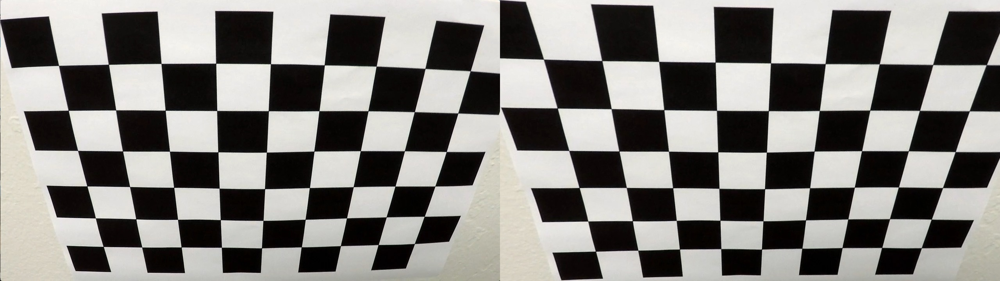
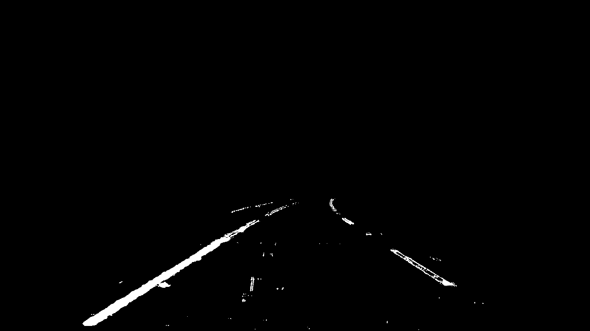
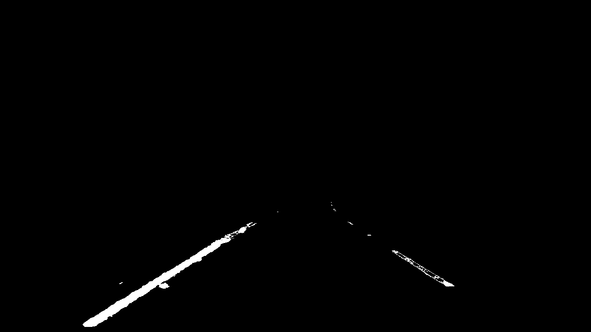
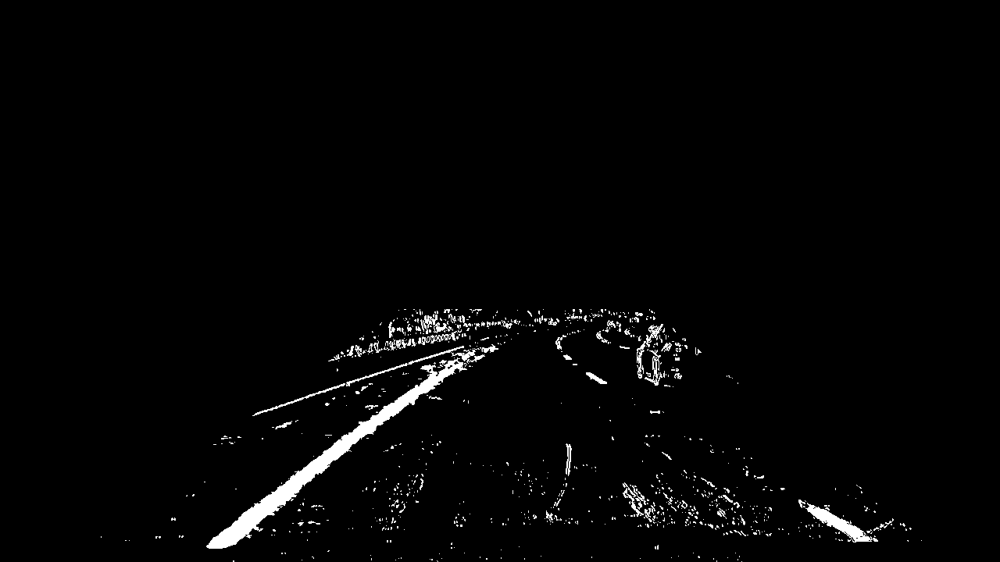
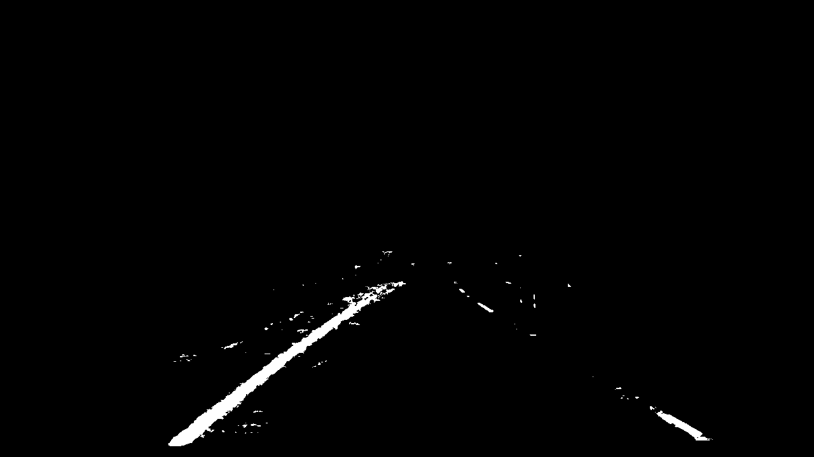
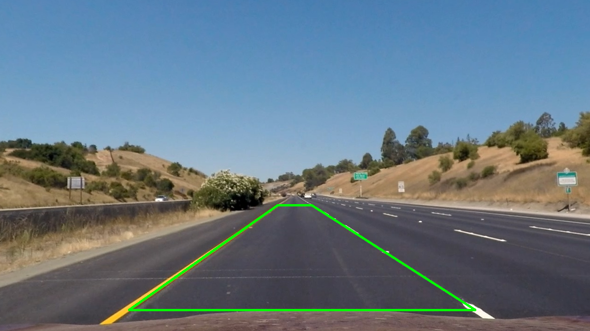
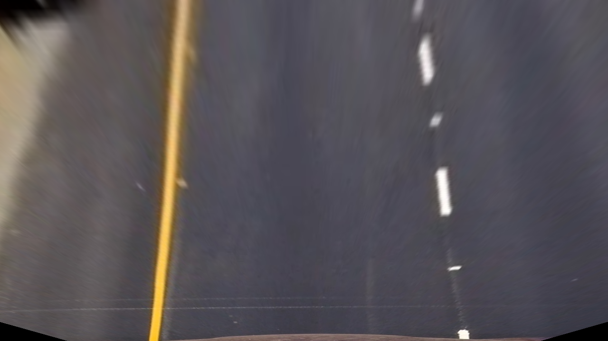
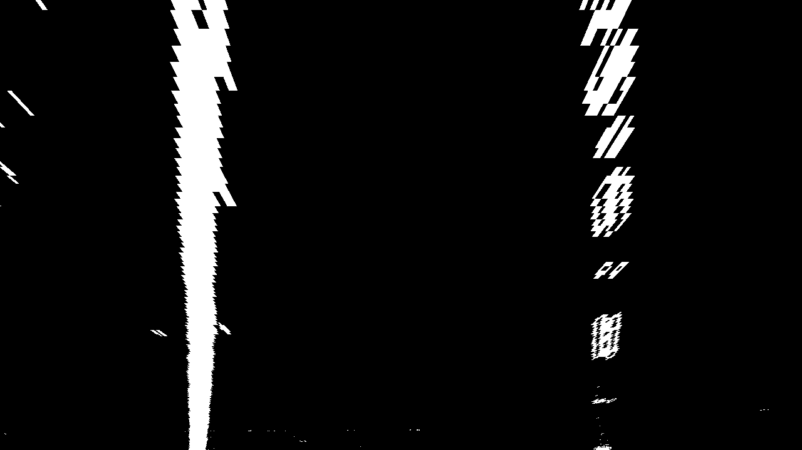

# lane-finding-project
## Writeup Template

### You use this file as a template for your writeup.

---

**Lane Finding Project**

The goals / steps of this project are the following:

* Compute the camera calibration matrix and distortion coefficients given a set of chessboard images.
* Apply a distortion correction to raw images.
* Use color transforms, gradients, etc., to create a thresholded binary image.
* Apply a perspective transform to rectify binary image ("birds-eye view").
* Detect lane pixels and fit to find the lane boundary.
* Determine the curvature of the lane and vehicle position with respect to center.
* Warp the detected lane boundaries back onto the original image.
* Output visual display of the lane boundaries and numerical estimation of lane curvature and vehicle position.

[//]: # (Image References)

[image1]: ./examples/undistort_output.png "Undistorted"
[image2]: ./test_images/test1.jpg "Road Transformed"
[image3]: ./examples/binary_combo_example.jpg "Binary Example"
[image4]: ./examples/warped_straight_lines.jpg "Warp Example"
[image5]: ./examples/color_fit_lines.jpg "Fit Visual"
[image6]: ./examples/example_output.jpg "Output"
[video1]: ./project_video.mp4 "Video"

---

### Writeup / README

#### 1. Provide a Writeup that includes all the rubric points and how you addressed each one.

You're reading it!

### Camera Calibration

#### 1. Briefly state how you computed the camera matrix and distortion coefficients. Provide an example of a distortion corrected calibration image.

TODO: Add your text here!!!
Camera calibration was performed using a set of chessboard images provided with the project. The chessboard contains 9 × 6 internal corners, which were used to establish correspondences between known 3D points and their detected 2D positions in the images.

First, the 3D object points were defined assuming that the chessboard lies on a flat plane (Z = 0). The corresponding 2D image points were detected using cv.findChessboardCorners() and further refined using cv.cornerSubPix() to improve their accuracy.

Only images with matching resolutions and successfully detected chessboard corners were used for calibration. A total of 15 out of 20 images were included.

The collected object and image points were then passed to cv.calibrateCamera() to calculate the camera matrix and distortion coefficients. The resulting RMS reprojection error was approximately 0.853 pixels.

The calculated parameters were saved to output_images/calibration.npz for reuse in subsequent processing steps.

Finally, lens distortion was corrected using cv.undistort(). The comparison below shows the original calibration image on the left and the corrected image on the right.

### Pipeline (single images)

#### 1. Provide an example of a distortion-corrected image.

#### 2. Describe how (and identify where in your code) you used color transforms, gradients or other methods to create a thresholded binary image.  Provide an example of a binary image result.

The binary thresholding pipeline was implemented in src/thresholding.py. It combines gradient-based and color-based techniques to identify potential lane marking pixels.

Gradient Thresholding

The distortion-corrected image was first converted to grayscale. The Sobel operator was then applied in the x-direction to detect intensity changes corresponding to lane marking edges.

The absolute gradient values were normalized to the range [0, 255], and a threshold of [20, 100] was applied to generate a binary mask.

Although this method detected lane marking edges, it also introduced noise from road textures, shadows, vehicles, and surrounding objects.

Color Thresholding

The distortion-corrected image was converted from BGR to HLS color space to identify white and yellow lane markings.

White markings were detected using high lightness and relatively low saturation values. Yellow markings were detected using a combination of hue, saturation, and lightness thresholds.

The two masks were combined using a logical OR operation to create a color-based binary image.

Region of Interest (ROI)

A trapezoidal region of interest was applied to reduce irrelevant detections outside the road area. The trapezoid coordinates were defined relative to the image dimensions.

Results

The gradient-based and color-based approaches were compared using test1.jpg and test5.jpg. The combination of Sobel and color masks introduced additional noise, while the color-based mask provided cleaner results and preserved the main lane markings.

Therefore, the color-based mask restricted to the ROI was selected for the subsequent processing steps.

The method still has limitations, particularly with partially obscured or poorly illuminated lane markings.

An example of the resulting binary image is shown below.

#### 3. Describe how (and identify where in your code) you performed a perspective transform and provide an example of a transformed image.

The perspective transformation was implemented in src/perspective_transform.py to obtain a bird's-eye view of the road and simplify lane detection.

The transformation was performed using four source points (src) and four corresponding destination points (dst). The source points were selected based on the lane boundaries in straight_lines1.jpg, which was used as a reference image because it contains an approximately straight road.

The selected source points were:

Bottom-left: (230, 700)

Top-left: (575, 455)

Top-right: (710, 455)

Bottom-right: (1050, 700)

The destination points form a rectangle, mapping the detected lane boundaries to approximately parallel vertical lines.

The transformation matrix M was calculated using cv.getPerspectiveTransform(), while cv.warpPerspective() was used to transform the image.

An inverse transformation matrix (M_inv) was also calculated for later use when projecting the detected lane area back onto the original road image.

The transformation was first tested on the distortion-corrected color image to verify the selected points. The same transformation was then applied to the binary image obtained from the thresholding pipeline.

Nearest-neighbor interpolation (cv.INTER_NEAREST) was used for the binary image to preserve its pixel values.

The resulting bird's-eye view shows approximately parallel lane boundaries, making it suitable for the subsequent sliding-window lane detection algorithm.

**Source Region — straight_lines1.jpg**

**Perspective Transformed Image — Bird's-eye View**

**Perspective Transformed Binary Image**

#### 4. Describe how (and identify where in your code) you identified lane-line pixels and fit their positions with a polynomial?

TODO: Add your text here!!!

#### 5. Describe how (and identify where in your code) you calculated the radius of curvature of the lane and the position of the vehicle with respect to center.

TODO: Add your text here!!!

#### 6. Provide an example image of your result plotted back down onto the road such that the lane area is identified clearly.

TODO: Add your text here!!!

### Pipeline (video)

#### 1. Provide a link to your final video output.  Your pipeline should perform reasonably well on the entire project video (wobbly lines are ok but no catastrophic failures that would cause the car to drive off the road!).

TODO: Add your text here!!!

### Discussion

#### 1. Briefly discuss any problems / issues you faced in your implementation of this project.  Where will your pipeline likely fail?  What could you do to make it more robust?

TODO: Add your text here!!!

